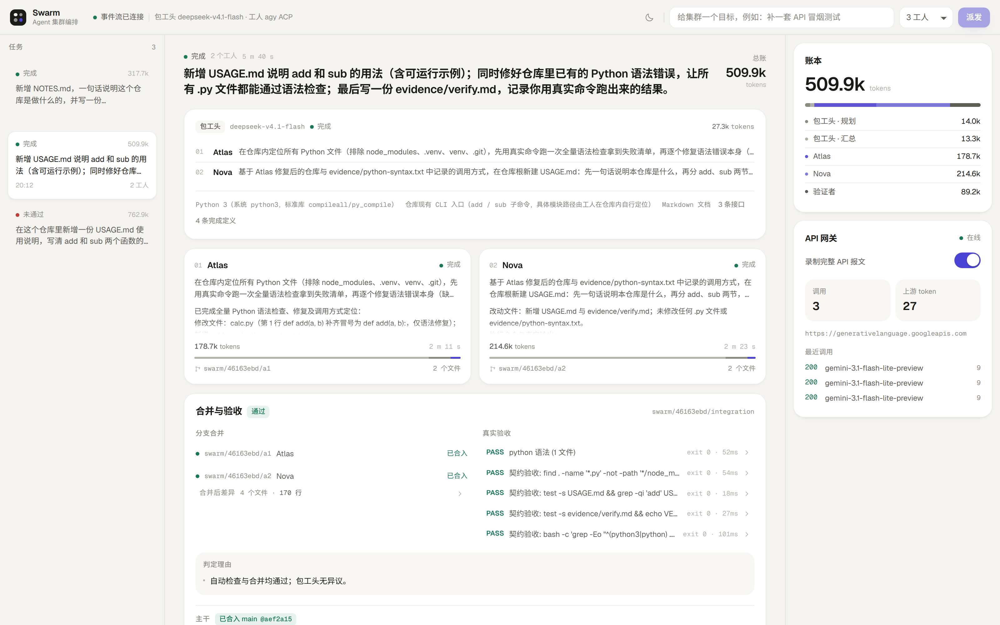
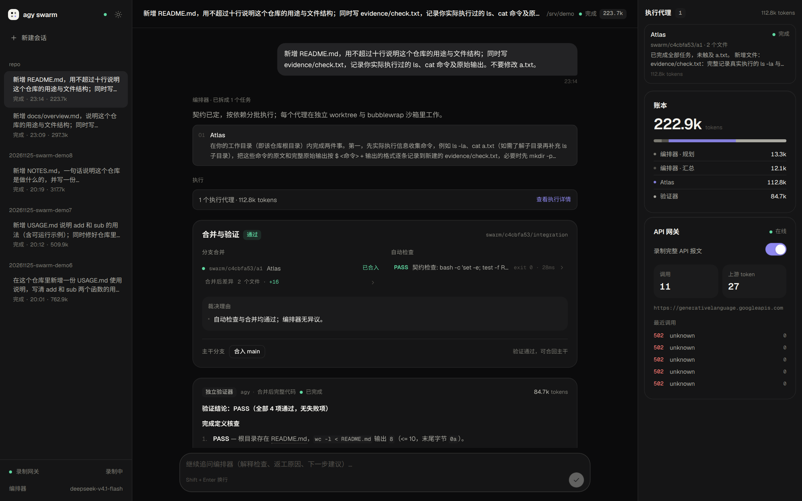
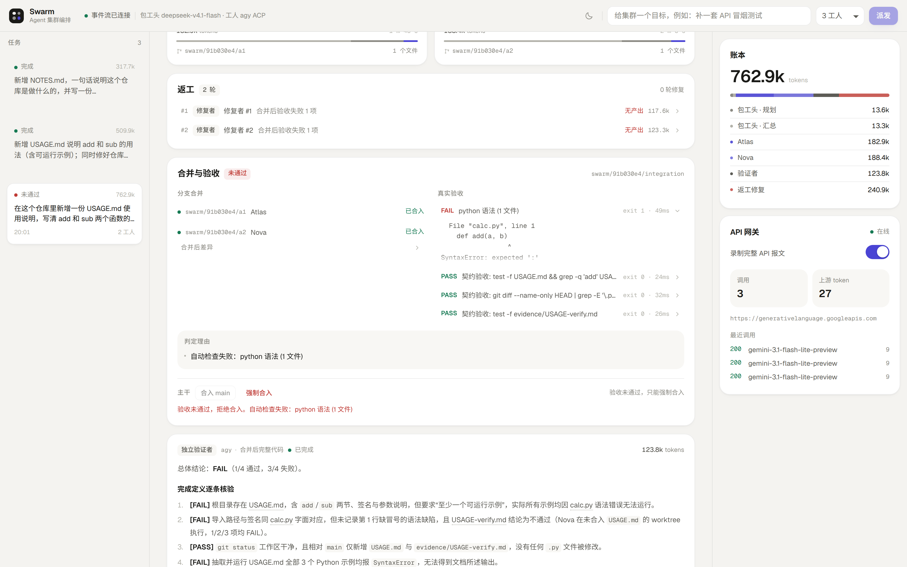

# agy-agent-swarm

Antigravity Agent Swarm。一个保守的编排层，负责约束 agy（Antigravity CLI）的执行范围，用真实命令和独立验证器
校验产出，只把通过检查的结果合回主干。

`Next.js 16` · `pi SDK` · `agy ACP` · `bubblewrap` · `git worktree` · `SSE` · 深浅双主题



<sub>一个真实任务：两个执行代理各自实现并自测，合并后 5 条自动检查全部通过，独立验证器复核通过，最终合入主干。</sub>

## 技术栈

- **编排器**：pi SDK（TypeScript）→ DeepSeek；工具调用经 JSON-RPC 驱动子进程。
- **执行协议**：Agent Client Protocol（ACP，stdio JSON-RPC）。
- **隔离**：git worktree 负责分支与历史；bubblewrap（bubble sandbox）负责文件系统与命名空间。
- **控制台**：Next.js 16 App Router，API Route + SSE，单进程全栈。

## 问题

Antigravity 模型能力不弱，但默认行为倾向于一次性完成整个工程：自行扩大范围、跳过验证、把没有运行过的代码
当作已完成。直接把它接到真实项目上，通常得到一个能演示、但工程上不可合并的仓库。

这个系统在 agy 前面加一层保守的编排约束：

- **契约先行**：编排器先定义技术栈、目录布局、接口签名、完成定义与合并后的检查命令，再切分任务。
- **沙箱执行**：每个执行代理运行在独立的 git worktree 与 bubblewrap 沙箱中；根文件系统只读，只有工作区可写。
- **证据验证**：合并后执行真实检查命令，记录 exit code 与原始输出；再由独立验证器从最终代码出发自行复核。
- **分层返工**：执行级问题回给代理重跑；只有在合并树上才暴露的问题交给修复代理。
- **合并门**：验证未通过时拒绝合入，只保留显式的强制合入。

编排器不写代码。它的职责是约束、验证和裁决。

## 架构

```
Next.js 控制台 (3100)
  ├─ 任务提交 / SSE 事件流 / 对话式控制台
  ├─ 编排器（单例）
  │    ├─ 规划 / 裁决：@earendil-works/pi-coding-agent → work2api (8787) → deepseek-v4.1-flash
  │    ├─ 执行代理池：每个任务 spawn agy acp 进程
  │    │    cwd     = 独立 git worktree
  │    │    sandbox = bubblewrap：/ 只读，worktree 与 agy 状态目录可写
  │    │    usage   = ACP session/prompt 返回值
  │    ├─ 验证器 / 修复代理：同样走 agy acp，cwd 指向合并后的 integration 树
  │    └─ 合并、返工、判定、合回主干
  └─ /api/gateway ──► 录制网关 (9000)
                         ├─ Gemini 兼容入口（/v1beta/models/*）
                         ├─ 虚拟 key → agent 归账
                         └─ 上游：任意 Gemini Developer API key
```

## 快速开始

```bash
./install.sh          # 检查 node/pnpm/agy/bwrap/编排器模型，安装依赖
node tools/sandbox-check.mjs   # 沙箱自检：在 bubblewrap 里完成 ACP 握手，不调用模型
pnpm dev              # http://localhost:3100
```

生产模式：`pnpm build && pnpm start`（端口 3100）。

可选：启动录制网关，让需要按 API 计量的代理走它。

```bash
cp <你的 key> data/upstream.key && chmod 600 data/upstream.key
pnpm gateway                                   # http://127.0.0.1:9000
SWARM_GATEWAY_URL=http://127.0.0.1:9000 SWARM_GATEWAY_KEY=vk-demo pnpm dev
```

## 执行沙箱

执行代理不是直接跑在宿主机上的。`server/acp.ts` 在 spawn agy 之前套一层 bubblewrap：

```
--ro-bind / /            根文件系统只读
--ro-bind /data /data    独立数据盘只读（存在时）
--dev-bind /dev /dev
--proc /proc
--tmpfs /tmp
--bind <worktree> <worktree>                    唯一可写的工作区
--bind ~/.cache/antigravity ~/.config/antigravity ~/.gemini ...
--die-with-parent --unshare-pid --unshare-ipc --unshare-uts --share-net
```

网络保持共享（模型 API 需要），PID / IPC / UTS 隔离，父进程退出时子进程一并回收。
这样即使代理在提示词层面越界，也无法改动工作区之外的仓库、其它任务或用户目录。

- 默认启用；`SWARM_SANDBOX=off` 退回直接 spawn。
- 找不到 `bwrap` 时自动退回直接 spawn；`BWRAP_BIN` 可指定路径。
- 已在沙箱内完成真实代理任务验证：创建文件、`git status`、回读文件均正常。

## 控制台

顶部输入目标与并发代理数，回车提交。三栏：

- **左：任务流**。每个任务显示状态、token 总量与代理数。
- **中：执行视图**。编排器契约与任务清单 → 执行代理卡片（实时输出、token 构成、分支、改动文件）
  → 返工记录 → 合并与验证（每条检查的 exit code、命令与原始输出、diff 统计）→ 独立验证器 → 编排器汇总。
- **右：账本与网关**。按角色分账并绘制占比条；网关面板显示在线状态、调用数、上游 token 与录制开关。

任务状态：规划中 → 集群执行 → 合并中 → 验证中 →（返工中）→ 汇总中 → 完成 / 失败。

主题默认跟随系统，右上角可切换；`⌘K` / `Ctrl+K` 聚焦目标输入，`Esc` 关闭代理详情。



<sub>深色形态：中性近黑底、单一靛色强调，状态色只出现在小圆点上。</sub>

验证失败的形态：



<sub>目标要求「不要修改任何 .py」，但仓库本身存在语法错误的 .py。卡片顶部直接给出失败项与错误首行；
修复代理复现后拒绝伪造，裁决如实 FAIL；返工开销（240.9k）在账本中单列，不混入执行代理花费。</sub>

## 编排契约

提示词集中在 `server/prompts.ts`，采用 orchestrator-worker 模式：

1. **共享契约**：编排器产出 `contract`（技术栈、目录布局、接口签名、完成定义、合并后的检查命令），
   所有执行代理在同一契约下工作。
2. **独立任务**：每个任务带 `scope`（只允许改动的路径）、`acceptance`（可执行验收项）、
   `evidence`（必须提交的证据）、`depends_on`（前置任务）。写作用域不允许重叠。
3. **分阶段推进**：执行器按 `depends_on` 分批；无依赖任务并行，依赖满足后进入下一批。
   有依赖的代理从**依赖方的最新提交**创建 worktree，打开目录即可看到上游产物。
4. **自证闭环**：执行代理必须运行测试、启动服务、使用浏览器截图，并声明「写到仓库外的产物视为未交付」。
5. **证据验证**：合并后在 integration 树上执行自动检查与契约中的 `verify` 命令。
6. **独立验证器**：合并完成后派一个 agy 验证代理，cwd 指向 integration 树。它看到最终完整代码，
   自行决定验证方式（起服务、截图、跑测试、curl），汇报中给出命令与原始证据。
   编排器裁决时，验证器的证据优先于执行代理的自述。

任务粒度约定为「新增一个功能 / 修一个明确缺陷」：1 到 3 个文件、十分钟内可完成、有可执行的验证方式。

## 合并与验证

所有执行代理从同一 base 仓库的同一提交出发，各自在 `swarm/<taskId>/aN` 分支的独立 worktree 中工作：

```
repo (main) ──●───────────────● integration
               \             /
                ├─ swarm/…/a1 ┘  merge --no-ff
                ├─ swarm/…/a2 ┘
                └─ swarm/…/a3 ┘
```

1. 代理结束后，编排器把 worktree 改动 commit 到**实际 HEAD 分支**（agy 可能自行切换过分支）。
2. 依次把各分支 `git merge --no-ff` 到 integration 分支。
3. 在 integration 树上自动探测并执行真实检查：`npm test`、`python3 -m py_compile`、`bash -n`、
   `node --check`、HTML 结构，加上契约中的 `verify` 命令；记录 exit code 与输出。
4. 编排器拿到「合并结果 + diff 统计 + 检查输出 + 验证器报告 + 代理自述」，只依据前四项给出 `{pass, reasons}`。

合并后的完整代码就在 `data/runs/<taskId>/integration`，分支 `swarm/<short>/integration`，无需从沙箱复制。

提交时排除 `__pycache__`、`node_modules`、`.next`、`.venv`、`.swarm-verify` 等运行时缓存。

## 返工

自动检查失败、代理未跑完或分支冲突时，编排器把失败证据交回给**真正能修改的那一层**，
默认最多 2 轮（`SWARM_REWORK_ROUNDS`）：

| 问题 | 执行者 | 位置 |
|---|---|---|
| 执行代理失败 / 分支合并冲突 | 该代理重跑 | 新建 worktree，基点 = 当前 integration 提交 |
| 仅自动检查失败（多份改动叠加后才暴露） | 修复代理（agy） | 直接在 integration 树上修，由系统提交 |

每轮结束后重新合并、重跑全部检查，账本单独记录返工开销。
修复代理没有修改任何文件即视为**停滞**，不再开启下一轮，直接携带证据进入裁决。
返工用尽仍未通过，判定 FAIL，不伪造成功。

## 合回主干

验证通过后，面板提供「合入 main」，实际执行：

```
git -C <base repo> merge --no-ff swarm/<id>/integration
```

基础仓库工作区必须干净（存在未提交改动会被拒绝）；合并失败自动 `merge --abort` 回滚。
验证未通过时按钮禁用，只保留「强制合入」。

## 记账

token 有三个来源，按角色分账：

- **编排器**：pi SDK 的 message usage，规划与汇总分开记。
- **执行代理 / 验证器 / 修复代理**：ACP `session/prompt` 返回的 usage（input/output/cached/thought/total）。
- **网关**（可选）：上游响应 usage，按虚拟 key 归到 agent，写入 `data/gateway/record-*.jsonl`。

代理重跑会累加到 `spent`，账本按累计花费展示；返工修复单列一行。

## 持久化

任务每次状态变化都会落盘到 `data/tasks/<id>.json`（原子写 + 400ms 尾随防抖，文本流不会打爆磁盘）。
重启后历史任务自动恢复，面板与账本保留；重启时仍处于运行中的任务标记为「中断」，
不会留下假的「执行中」状态。worktree 与 integration 目录位于 `data/runs/`，重启后仍可补合主干。

## HTTP API

| 方法 | 路径 | 作用 |
|---|---|---|
| GET | `/api/tasks` | 任务列表 |
| POST | `/api/tasks` | 提交任务：`{goal, agents?, repoPath?}` |
| GET | `/api/tasks/:id` | 单个任务快照 |
| GET | `/api/tasks/:id/diff` | 各执行代理 worktree 的改动统计 |
| POST | `/api/tasks/:id/promote` | 合回主干：`{force?}` |
| GET | `/api/stream` | SSE 事件流（snapshot / task / agent / boss） |
| GET/POST | `/api/gateway` | 网关状态；`{action:"record"\|"keys", payload}` |

## 环境变量

| 变量 | 默认 | 说明 |
|---|---|---|
| `BOSS_PROVIDER` / `BOSS_MODEL` | `1` / `deepseek-v4.1-flash` | 编排器模型，来自 `~/.pi/agent/models.json` |
| `AGY_BIN` | `~/.local/bin/agy` | Antigravity CLI |
| `SWARM_SANDBOX` | `bwrap` | `off` 关闭 bubblewrap 沙箱 |
| `BWRAP_BIN` | `/usr/bin/bwrap` | bubblewrap 路径 |
| `SWARM_ROOT` | `./data/runs` | 每个任务的 worktree 根目录 |
| `SWARM_AGENT_TIMEOUT_MS` | `600000` | 单个执行代理超时 |
| `SWARM_VERIFIER_TIMEOUT_MS` | `600000` | 独立验证器超时 |
| `SWARM_FIXER_TIMEOUT_MS` | `600000` | 修复代理超时 |
| `SWARM_REWORK_ROUNDS` | `2` | 检查失败后最多返工轮数（0 关闭） |
| `SWARM_TASKS_DIR` | `./data/tasks` | 任务持久化目录 |
| `SWARM_GATEWAY_URL` / `SWARM_GATEWAY_KEY` | — | 设置后执行代理走录制网关 |
| `SWARM_GATEWAY_CONTROL` | `http://127.0.0.1:9000` | 面板查询网关用的地址 |
| `GATEWAY_PORT` | `9000` | 网关端口 |
| `UPSTREAM_BASE_URL` | `https://generativelanguage.googleapis.com` | 网关上游 |
| `UPSTREAM_KEY` 或 `data/upstream.key` | — | 网关上游 key |

## 已验证的能力

- `agy acp` 可程序化驱动；`session/prompt` 返回完整 usage（input/output/thought/cached/total）
- bubblewrap 沙箱内 ACP 握手、文件写入、`git status` 与命令输出均正常
- 编排器经 pi SDK 派发，工具调用真实驱动独立 agy 进程
- 3 个执行代理并发、各自 worktree、互不干扰（实测 24.5s 全部完成）
- 网关按虚拟 key 把 token 归到 agent，可按开关录制完整请求/响应（`data/gateway/*.jsonl`）
- **返工闭环**：合并后 `python 语法` 检查失败 → 修复代理在 integration 树上复现 →
  因目标与缺陷冲突而拒绝伪造 → 判定 FAIL（762.9k tokens，返工 240.9k 单独入账）
- **依赖可见性**：下游代理的 worktree 直接基于上游提交创建，打开目录即可看到 `evidence/python-syntax.txt`
- **一键合主干**：`main` 拿到 `Merge branch 'swarm/…/integration'`（commit `aef2a15`），验证未通过的任务被拒绝合入
- **持久化**：重启后任务、账本、返工记录与合主干结果原样恢复

## 当前边界

- 沙箱隔离的是文件系统与 PID/IPC/UTS，网络仍然共享（模型 API 需要）；需要断网隔离时自行加 `--unshare-net` 并配置代理。
- `bwrap` 依赖非特权 user namespace；不支持的环境下自动退回直接 spawn，隔离性随之消失。
- 执行代理默认走 agy 自身的 OAuth（账号由 `antigravity-tools switch` 管理），不经过 8045：
  `agy` 只认 Gemini 原生协议，8045 对外是 OpenAI 兼容协议，两者不通。
- 网关的虚拟 key 模式需要把 `SWARM_GATEWAY_URL` 指过去；没有有额度的上游 key 时会 429。
- 返工一轮只处理一类问题：先修执行代理/冲突，再修自动检查；冲突分支不会被静默跳过。
- 验证器的报告只作为裁决依据，不参与触发返工；触发返工的只有真实检查项。
- 「中断」的历史任务只恢复展示和合主干，不会自动续跑。
- 一个任务最多 8 个执行代理；单进程内存编排，未做多实例/队列。
- 只保存 diff 统计，不保存逐行 patch，因此界面无法展示内容级 diff。

## 目录

```
app/            页面、API 路由、主题启动脚本
components/
  Console.tsx   状态、SSE 与三栏编排
  console/      任务流、执行视图、验证、返工、账本、网关、代理详情
  ui/kit.tsx    基础组件（卡片、标签、按钮、展开、主题切换）
lib/types.ts    共享类型
DESIGN.md       视觉规范：6-3-1 配色预算、字号、间距、动效、禁止项
server/
  orchestrator.ts  规划、派发、合并、返工、验证、裁决、合主干
  acp.ts           agy ACP 客户端 + bubblewrap 沙箱
  gateway.ts       Gemini 兼容录制网关
  prompts.ts       提示词契约
  store.ts         任务表 + 事件总线 + 落盘恢复
tools/
  shot.mjs         控制台截图（主题、滚动、路径中性化）
  sandbox-check.mjs  bubblewrap + ACP 握手自检
  worker-shot.mjs  给执行代理用的截图工具
data/           运行时数据（不入库）
  runs/<taskId>/   各代理 worktree、integration、orchestrator
  tasks/<taskId>.json  任务快照
  gateway/*.jsonl  网关录制
docs/screenshots/  控制台截图（浅色 / 深色 / 返工）
```

## License

MIT
